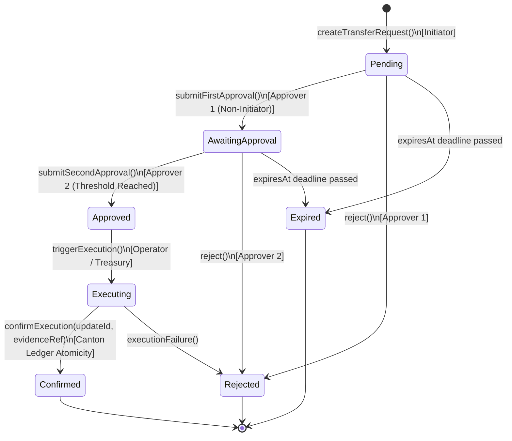
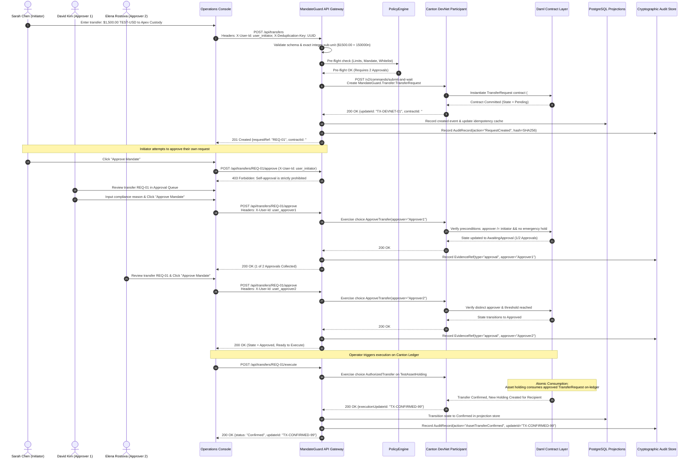
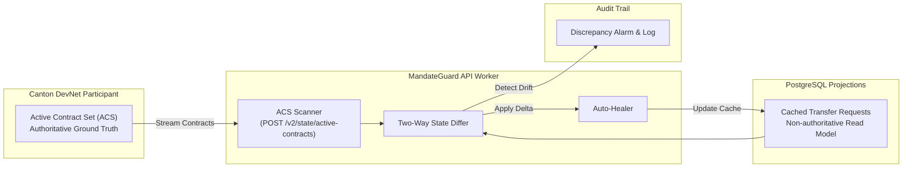

# MandateGuard Transaction Authorization Lifecycle

## 1. State Machine Overview

The lifecycle of an institutional transfer request is governed by a strict, deterministic state machine enforced by Daml smart contracts. A transfer request is **not** an executed transfer; an approval is **not** a confirmed settlement.

---

## 2. End-to-End Transaction Flow

---

## 3. Discrepancy Reconciliation & Self-Healing

In production financial networks, network partitions or transient crashes can cause the read-model projection store (e.g. PostgreSQL) to become out of sync with the true Active Contract Set (ACS) on the Canton ledger.

1. **Periodic & Triggered Scans:** The backend worker queries `/v2/state/active-contracts` using template filters (`MandateGuard.Transfer:TransferRequest`).
2. **Two-Way Differ:** Compares contract IDs, states, approval counts, and quantities between the ledger payload and the local database.
3. **Self-Healing:** If an off-ledger database record is out of sync, the local store is automatically updated to reflect the ledger truth, and an audit warning is generated.
