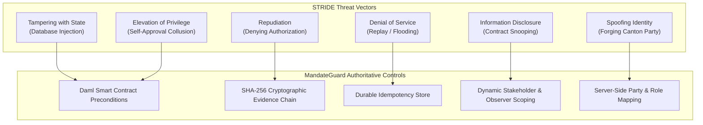
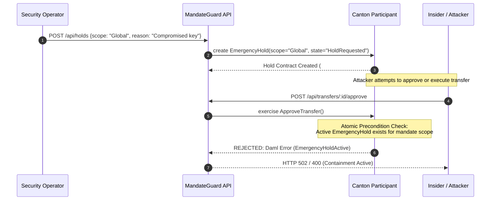

# MandateGuard Threat Model & Attack Surface Analysis

## 1. Scope & Objective

This document formalizes the threat model for **MandateGuard**, an institutional digital-asset mandate firewall deployed on the **Canton Network**. It systematically assesses attack vectors, threat actors, security assumptions, and verification evidence according to the STRIDE threat methodology.

---

## 2. Threat Actors & Capabilities

| Threat Actor | Description | Capabilities | Access Level |
| :--- | :--- | :--- | :--- |
| **Malicious Insider (Initiator)** | An authenticated employee authorized to create transfer requests. | Can craft valid JSON payloads, submit high-volume requests, attempt to self-approve. | Possesses valid client session with `TransactionInitiator` role. |
| **Compromised Approver** | An approver whose device or credentials have been compromised. | Can approve pending requests, submit approval decisions with arbitrary reason codes. | Possesses valid client session with `TransactionApprover` role. |
| **Rogue Systems Administrator / DBA** | An operator with direct physical or SSH access to the backend host or PostgreSQL DB. | Can alter database records, modify cached projections, truncate audit tables. | Full database write access, no Canton participant private keys. |
| **Network Man-in-the-Middle (MitM)** | An attacker on the local network intercepting HTTP traffic between frontend and API. | Can inspect payloads, attempt replay attacks, alter transit values. | Network eavesdropping and packet injection. |
| **Untrusted Counterparty** | A compromised or fraudulent recipient attempting to claim unauthorized assets. | Can attempt direct asset transfers, claim unauthorized beneficiary status. | Controls external Canton party, no institutional internal role. |

---

## 3. STRIDE Threat Analysis Matrix



### 3.1 Spoofing (Identity Spoofing)
- **Attack:** An attacker injects `X-User-Id: user_treasury` into browser headers to impersonate a Treasury Controller.
- **Mitigation:** The API server resolves logical roles server-side and checks session credentials. More crucially, the underlying Canton Ledger API enforces party authorization cryptographically: an unauthorized party cannot sign a transaction or exercise choices on contracts where they are not the controller.

### 3.2 Tampering (Data Tampering)
- **Attack:** An attacker with database access alters the `state` column of a `TransferRequest` in PostgreSQL from `Pending` to `Approved`.
- **Mitigation:** Projections in PostgreSQL are non-authoritative read-models. At execution time, the choice `ConfirmExecution` or `AuthorizedTransfer` must be exercised directly against the authoritative Daml contract on the Canton participant. If the Daml contract is not in the `Approved` state, Canton rejects the transaction.

### 3.3 Repudiation (Disputing Transactions)
- **Attack:** An approver claims they never approved a fraudulent $50,000 transfer.
- **Mitigation:** Every approval creates an immutable `ApprovalRecord` contract on-ledger and a deterministic SHA-256 `EvidenceRef` digest capturing the approver party, decision, reason memo, and exact timestamp.

### 3.4 Information Disclosure (Contract Visibility Breach)
- **Attack:** An unassociated institution or observer monitors transactions between Institution A and Vendor B.
- **Mitigation:** Daml contract privacy restricts contract visibility strictly to signatories and explicitly declared observers (`observer initiator :: (currentApprovals ++ eligibleApprovers)`). Outside parties cannot view or query contracts on Canton.

### 3.5 Denial of Service (Replay Attacks & Flooding)
- **Attack:** An attacker captures a valid transfer request and replays it 1,000 times to drain institutional balances.
- **Mitigation:** MandateGuard requires an `X-Deduplication-Key` header on all mutation endpoints. Replay attempts within the submission deduplication window return HTTP 409 Conflict without invoking the ledger.

### 3.6 Elevation of Privilege (Self-Approval Collusion)
- **Attack:** An initiator creates a $500,000 transfer to an accomplice and immediately signs off on the approval.
- **Mitigation:** Enforced at both application and contract boundaries. In `MandateGuard.Transfer:ApproveTransfer`:
  ```daml
  assertMsg "Initiator cannot approve own request" (approver /= initiator)
  ```
  The Canton ledger rejects the transaction with an interpretation error if `approver == initiator`.

---

## 4. Emergency Containment Circuit Analysis

MandateGuard implements an atomic emergency containment breaker:



The containment hold is verified in real-time on-ledger and blocks any pending or in-flight transfer execution atomically.
